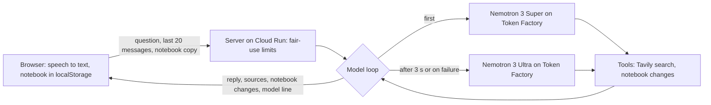

# Nion

A hands-free voice companion for travelers. Say "Hey Nion" and it answers out loud, searches the web, and keeps a trip notebook (memories, expenses, to-do and to-visit lists, reminders, email drafts). It is a hosted web app. You can also type to it.

Built for the **Nebius x NVIDIA Global AI Hackathon**, **Best Apps and Agents** track. Every answer comes from an **NVIDIA Nemotron** model served by **Nebius Token Factory**, and web search comes from **Tavily**.

- **Live demo:** https://nion-264656329782.us-central1.run.app (kept open to judges until 2026-12-15)
- **Code:** this repository, MIT license

## Try it

1. **No microphone needed:** open the **How to try** card and tap **Load a sample trip**. It fills the notebook with marked sample entries. Then type "show my expenses". Tap it again to remove the sample.
2. **Typing works in any browser:** use the text box or the example buttons.
3. **Voice needs Chrome or another Chromium browser.** Tap **Turn on Nion** once, allow the microphone, and say "Hey Nion, ..." Safari's speech recognition does not hear reliably, so Nion hides the Turn on button there and offers typing.

Things to say or type:

| Say | What happens |
|---|---|
| "Hey Nion, what's the latest world news?" | Searches the web (Tavily) and answers with sources |
| "I just spent 12 dollars on lunch" | Saves an expense. "How much have I spent today?" totals it |
| "Remind me in 5 minutes to stretch" | A reminder, spoken aloud when due (only while the page is open) |
| "Add the old town to my to-visit list" | Adds to the to-visit list. "Show my to-do list" opens it |
| "Draft an email to Maria saying I'll be late" | Saves a draft. Nion never sends email: you open it in your own mail app, share it or copy it |
| "Where can I eat near me?" | Uses your device location or a place you name |

After an answer there is a 15-second follow-up window with no wake phrase needed. You can interrupt Nion by talking, pressing Escape, tapping the circle or tapping **Stop**. **Start conversation** keeps it listening until you end it.

Under each answer a model writes, a line shows what happened, for example `NVIDIA Nemotron 3 Super · Nebius Token Factory · 4.2 s · 1 web search (Tavily)`. A banner under the title names the stack.

The **Notebook** page shows, ticks off, copies, exports and clears everything. The **History** page keeps one entry per sitting.

## How it uses NVIDIA Nemotron and Nebius Token Factory

- The server calls Token Factory's OpenAI-compatible API (`https://api.tokenfactory.nebius.com/v1/`) with plain `fetch`, in [`server/providers/nebius.js`](server/providers/nebius.js). No other model provider is used.
- **Everyday model:** `nvidia/nemotron-3-super-120b-a12b` (Nemotron 3 Super, 120B, 12B active).
- **Stronger model:** `nvidia/Nemotron-3-Ultra-550b-a55b` (Nemotron 3 Ultra, 550B, 55B active). If Super has not answered after **3 seconds**, the same request is also sent to Ultra and the first answer wins. If Super fails or returns nothing, Ultra takes over for the rest of that question. The line under the answer says "(stepped in)" when that happened.
- **Tool loop:** the model can call 11 tools for up to 4 rounds and 22 seconds: `web_search` (Tavily), `remember`, `forget`, `add_expense`, `add_to_list`, `update_list_item`, `set_reminder`, `cancel_reminder`, `show_panel`, `hide_panel`, `save_draft`.
- **Notebook in the instructions:** the notebook travels with each request and goes into the model's instructions, so recall questions ("how much did I spend today?") need no tool call.
- **Nemotron 3 Nano** was benchmarked and rejected: slower, far more output tokens, and it invented details. See [docs/benchmark.md](docs/benchmark.md).
- **Measured results** (live benchmark, 20 checks per model, 2026-10-21): Super passed 19 of 20 (median 2.0 s, slowest 5.7 s); Ultra passed 20 of 20 (median 2.4 s, slowest 6.3 s). Details, and the earlier three-model run, are in [docs/benchmark.md](docs/benchmark.md).
- **Not used:** Nebius Serverless or AI Cloud. The app runs on Google Cloud Run.



## Run it on your computer

You need **Node.js 22 or newer**, a **Nebius Token Factory API key** (required) and a **Tavily API key** (optional; without it Nion says it cannot look things up).

```bash
git clone https://github.com/SanjeeV-15/Nion-Nebius.git
cd Nion-Nebius
npm install
cp .env.example .env      # then put your own keys in .env
npm start
```

Open http://localhost:3000 (or run `PORT=3100 npm start` to use another port). `.env` is ignored by git: never commit it or share it.

| Setting in `.env` | Meaning |
|---|---|
| `NEBIUS_API_KEY` | Token Factory key. Required |
| `TAVILY_API_KEY` | Tavily key, for web search |
| `NION_MODEL` | Everyday model. Default `nvidia/nemotron-3-super-120b-a12b` |
| `NION_FALLBACK_MODEL` | Stronger model. Default `nvidia/Nemotron-3-Ultra-550b-a55b`. `same` retries the everyday model, `none` turns the fallback off |
| `NION_DAILY_CAP` | Questions per day for the whole site. Default 3000 |
| `NION_RATE_PER_HOUR` | Questions per visitor per hour. Default 200 |
| `NION_IP_RATE_PER_HOUR` | Questions per network address per hour. Default 1000 |
| `NION_JUDGE_PASS` | A secret of 8 or more characters. A link ending `?pass=THAT` skips the hourly limits and has its own daily cap |
| `NION_JUDGE_DAILY_CAP` | Daily cap for the judge pass. Default 5000 |
| `NION_TRUST_PROXY` | How many proxies sit in front of Nion. Default 1 |
| `PORT` | Port to listen on. Default 3000 |

Open `/?debug` to see a log of what Nion hears and decides, and `/?reset` to forget your name, History and notebook on this device.

## Tests and checks

```bash
npm test             # 360 tests; they use pretend services, so no keys are needed and nothing is spent
npm run preflight    # scans for secrets before you push or upload anything
node scripts/benchmark.mjs                       # a free dry run of the benchmark (pretend service)
node --env-file=.env scripts/benchmark.mjs --live    # the real benchmark: makes paid requests
```

## Where your data goes

Nion is not "fully private": voice and question text leave your device.

| Data | Goes to | Kept |
|---|---|---|
| Your voice | Chrome's speech service (Google) | Not stored by Nion |
| Spoken answers | Your browser's own speech voice (some browser voices run in the cloud) | Not stored by Nion |
| Your question, last 20 messages, name, time zone, local date and time, place, and a copy of your notebook | Nion's server, then Nebius Token Factory | The server stores nothing on disk |
| Search words written by the model | Tavily | Not stored by Nion |
| GPS coordinates (only if you allow location) | The server, then OpenStreetMap's Nominatim | Not stored by Nion |
| Notebook, name, History | Your browser's storage only | Your browser. Clearing site data removes them |
| A random visitor ID and, for judges, the pass | The server, for usage limits | In-memory counters, reset on restart |
| Every request | Google Cloud Run keeps its own request logs, as hosts do | Nion's own log line per question has counts and tokens, not your text |

There are no accounts and no database.

## Deploy

The [`Dockerfile`](Dockerfile) builds a small image (Node 22 Alpine, no keys inside). The host supplies `NEBIUS_API_KEY`, `TAVILY_API_KEY`, optionally `NION_JUDGE_PASS`, and `PORT`. The live demo runs on Google Cloud Run: see [docs/deploy-cloud-run.md](docs/deploy-cloud-run.md).

## Known limits

- Hands-free voice (the wake phrase) needs Chrome or another Chromium browser. Safari gets typing only.
- Nion works only while its page is open. Reminders are spoken only then; one that came due while the page was closed is spoken the next time it opens.
- The notebook lives in one browser on one device and does not sync.
- Usage limits keep the public demo fair. The counters are in memory and reset when the host restarts or wakes from idle.
- The first question after the site has been idle can take a few extra seconds (cold start).
- Not verified on real phones: the install prompt ("Add to Home Screen"), the share sheet and the mail app. Not tested: screen readers, color contrast, languages other than English.

## Folders

| Folder | Contents |
|---|---|
| `server/` | The Express server, the model provider (`providers/nebius.js`), the tools, the prompt and the fair-use limits |
| `shared/` | Code used by both server and browser: notebook rules, times, panels, model labels, the sample trip |
| `public/` | The pages and the browser code (voice, notebook, History) |
| `tests/` | The automated tests |
| `scripts/` | The benchmark, the secret scan and the icon maker |
| `docs/` | The benchmark, the Cloud Run guide and the traveler interview guide |

## Credits and AI assistance

- Models: NVIDIA Nemotron, served by Nebius Token Factory. Web search: Tavily. Place lookup: OpenStreetMap Nominatim.
- Nion began as a Build With AI: Basics project in October 2026 (Claude was its brain). This version replaces Claude with Nemotron, and no Claude code remains in the app.
- It was built with Claude Code (Anthropic), which helped write and test the code under the author's direction.

## License

MIT. See [LICENSE](LICENSE).
